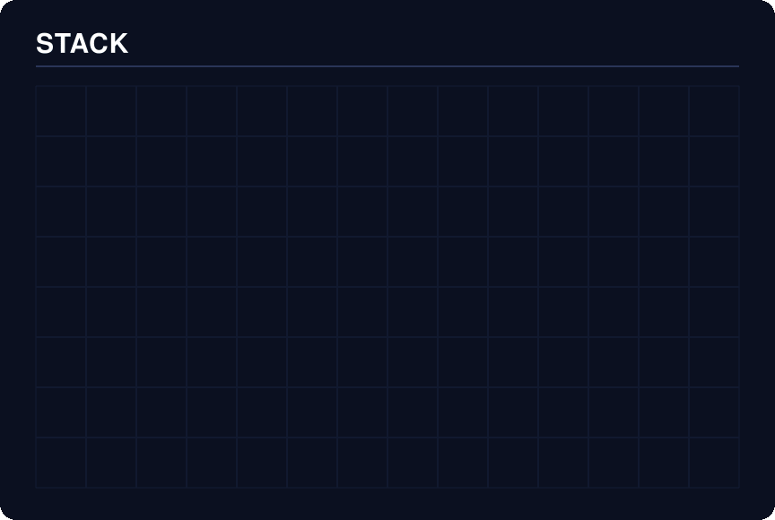

# Stacktris

Generate animated falling-block tech-stack graphics for your README.

<p align="center">
  
</p>

<p align="center"><em>Supplied animated demo (153 frames, ~12 s). The generated SVG
plays the same falling animation natively via CSS keyframes.</em></p>

Pick your skills, colours, and drop timing — Stacktris packs them as
tetromino-shaped pieces onto a bevelled tile board with brand logos, CSS
keyframe falling animations, and `prefers-reduced-motion` support. The output
is a single standalone SVG with no external dependencies — paste it straight
into your GitHub profile README.

> **Animated preview vs. SVG output:** The GIF above is a pre-recorded
> animation preview. The actual generator produces a standalone `.svg` file
> whose falling animation is driven by CSS `@keyframes` — it respects
> `prefers-reduced-motion` and renders at full resolution. See
> [`output/stack.svg`](output/stack.svg) for the generated default.

## Quickstart

```bash
# Clone and generate the default demo
git clone https://github.com/ZenzerJs/stacktris.git
cd stacktris
python3 -m stacktris -o stack.svg
```

That's it — no `pip install`, no virtual environment required.
Stacktris uses **only the Python standard library** (Python 3.10+).

## Usage

```bash
# Default 24-skill demo board
python3 -m stacktris

# Pick specific skills
python3 -m stacktris --skills Python React TypeScript Docker --columns 8

# Use a JSON config file
python3 -m stacktris --config examples/custom_colors.json -o my_stack.svg

# List all built-in skills
python3 -m stacktris --list-skills

# Custom animation timing
python3 -m stacktris --step 0.05 --stagger 0.15 --seed 42 --title "MY STACK"
```

### CLI Options

| Flag | Default | Description |
|------|---------|-------------|
| `-o`, `--output` | `stack.svg` | Output file path |
| `-c`, `--config` | — | JSON config file |
| `--skills` | all 24 | Space-separated skill names |
| `--seed` | `11` | Random seed for layout + wave order |
| `--columns` | `14` | Board width in columns |
| `--cell-size` | `56` | Cell size in pixels |
| `--step` | `0.07` | Seconds per row drop tick |
| `--stagger` | `0.22` | Delay between pieces in a wave |
| `--title` | `STACK` | Title text at top of graphic |
| `--list-skills` | — | Print built-in skill names and exit |
| `--version` | — | Print version and exit |

## Configuration

For full control, use a JSON config file:

```json
{
  "skills": [
    { "label": "Python" },
    { "label": "React", "color": "#4ecdc4" },
    { "label": "TypeScript" },
    { "label": "Docker" },
    { "label": "FastAPI" },
    { "label": "Prisma" }
  ],
  "board_columns": 10,
  "seed": 42,
  "step": 0.05,
  "stagger": 0.18,
  "title": "TOOLKIT",
  "background": "#1a1a2e"
}
```

### Config fields

| Field | Type | Default | Description |
|-------|------|---------|-------------|
| `skills` | array | *required* | List of skill objects |
| `skills[].label` | string | *required* | Skill name (case-insensitive for built-ins) |
| `skills[].color` | string | auto | Hex colour `#rrggbb` (auto-filled for built-ins) |
| `skills[].icon` | string | auto | Icon slug (auto-filled for built-ins) |
| `board_columns` | int | `14` | Board width |
| `cell_size` | int | `56` | Cell size in pixels |
| `seed` | int | `11` | Random seed |
| `step` | float | `0.07` | Drop speed (seconds per row) |
| `stagger` | float | `0.22` | Intra-wave delay |
| `wave_pause` | float | `0.22` | Pause between waves |
| `start_delay` | float | `0.4` | Delay before first drop |
| `hold` | float | `0.6` | Rest time after board is complete |
| `title` | string | `STACK` | Header text |
| `background` | string | `#0b1020` | Background colour |
| `grid_color` | string | `#141b33` | Grid line colour |
| `separator_color` | string | `#2a3558` | Title separator colour |
| `border_color` | string | `#050814` | Piece outline colour |

See the [`examples/`](examples/) directory for ready-to-use configs.

## Supported Skills

24 built-in skills with brand colours and logos:

| Skill | Colour | Icon |
|-------|--------|------|
| Docker | `#2496ed` | docker |
| FastAPI | `#009688` | fastapi |
| GitHub Actions | `#2088ff` | githubactions |
| HTML/CSS | `#8b5cf6` | html5+css |
| Java | `#ed8b00` | java |
| JavaScript | `#f7df1e` | javascript |
| LangChain | `#1c3c3c` | langchain |
| LangGraph | `#1c3c3c` | langgraph |
| MediaPipe | `#0097a7` | mediapipe |
| Next.js | `#000000` | nextdotjs |
| Node.js | `#5fa04e` | nodedotjs |
| Ollama | `#000000` | ollama |
| Playwright | `#2ead33` | playwright |
| Prisma | `#2d3748` | prisma |
| Python | `#3776ab` | python |
| PyTorch | `#ee4c2c` | pytorch |
| React | `#61dafb` | react |
| SQLite | `#003b57` | sqlite |
| Swift | `#f05138` | swift |
| Tailwind | `#06b6d4` | tailwindcss |
| TypeScript | `#3178c6` | typescript |
| Typst | `#239dad` | typst |
| Vercel | `#000000` | vercel |
| Vitest | `#6e9f18` | vitest |

## Embedding in Your README

Use the raw GitHub URL to embed the animated SVG:

```markdown

```

Or reference it relative to the repo root:

```markdown

```

### GitHub caching

GitHub proxies images through `camo.githubusercontent.com` and caches them
aggressively. After updating your SVG, the cached version may take minutes to
hours to refresh. Append a cache-busting query string if needed:

```markdown

```

## Accessibility

- SVG includes `role="img"`, `aria-label`, `<title>`, and `<desc>` elements
- `@media (prefers-reduced-motion: reduce)` disables all CSS animation in the
  generated SVG instantly, showing the completed board as a static image
- The GIF preview in this README is a raster animation and **does not** respond
  to `prefers-reduced-motion` — users who prefer reduced motion should embed
  the SVG output instead, which honours that media query natively
- All text labels and icons are inline — no external fonts or images to load

## Limitations

- **Layout packing:** The demo's 24-skill layout is hand-tuned for a perfectly
  filled 14-column board. Custom skill sets use an automatic packer that finds
  valid placements but may leave gaps in the grid. Very large skill counts
  (30+) on narrow boards may fail to pack.
- **Tetromino shapes only:** Every piece is exactly 4 cells in a standard
  tetromino shape (I/O/T/S/Z/L/J). Custom shapes are not supported.
- **Built-in icons only:** The 24 bundled Simple Icons logos are the supported
  set. Adding new icons requires editing `stacktris/icons.py`.
- **Static SVG:** The falling animation plays once; it does not loop. GitHub
  profile READMEs re-trigger the animation each time the page loads.
- **No GIF/video export:** Output is SVG only. Use external tools (e.g.
  `cairosvg`, Inkscape, or a browser screenshot) to convert to PNG/GIF.

## Development

```bash
# Run tests
python3 -m pytest tests/ -v

# Generate all example outputs
python3 -m stacktris -o output/stack.svg
python3 -m stacktris -c examples/minimal.json -o output/minimal.svg
python3 -m stacktris -c examples/custom_colors.json -o output/custom.svg
```

## Project Structure

```
stacktris/
├── stacktris/          # Python package
│   ├── __init__.py     # Version
│   ├── __main__.py     # python -m stacktris entry
│   ├── cli.py          # Argument parsing
│   ├── config.py       # Config loading/validation
│   ├── generator.py    # SVG generation engine
│   ├── icons.py        # Simple Icons SVG paths
│   └── layout.py       # Tetromino packing
├── examples/           # JSON config examples
├── output/             # Generated SVG files
├── tests/              # Test suite
├── .github/workflows/  # CI
├── LICENSE             # MIT (original code)
├── THIRD_PARTY_NOTICES.md
└── pyproject.toml
```

## Contributing

Contributions welcome! Please open an issue or PR.

Before submitting, ensure tests pass:

```bash
python3 -m pytest tests/ -v
```

## Licence

Original code is [MIT](LICENSE) licensed. Copyright (c) 2026 Jayden Saha.

Brand logos are sourced from [Simple Icons](https://simpleicons.org) (CC0-1.0
artwork licence). Individual brand marks remain trademarks of their respective
owners. See [THIRD_PARTY_NOTICES.md](THIRD_PARTY_NOTICES.md) for details.

This project is not affiliated with The Tetris Company.
